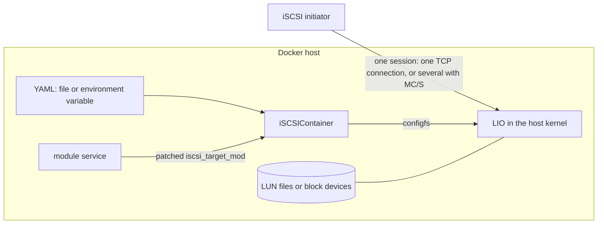

# iSCSIContainer

An iSCSI target in a Docker container, configured by one YAML document in the stack.
It drives the Linux kernel target (LIO) of the Docker host. Optionally it allows MC/S (Multiple
Connections per Session), so a single LUN can use more than one network link; by default each session
has a single connection.

> **Status:** in development. There is no release yet.

## How it works

- LIO is part of the host kernel. The container loads the target modules, builds the configuration in
  the kernel from the YAML on start, and clears it on stop. Nothing is saved.
- The YAML is the only source of the configuration. To change it, edit the YAML and restart the
  container; connected initiators reconnect.
- The portal binds to specific addresses or to all addresses of one or more interfaces, as set in the
  YAML; there is no default. With `network_mode: host`, the recommended setup, these are
  interfaces of the host under their host names. IPv4 and IPv6 are used as configured.
  Addresses are read at start only; where the IPv6 prefix changes, name the stable addresses (IPv4
  and ULA) instead of an interface.
- The container needs `privileged: true`. Nothing else on the host may manage the LIO configuration.
- Linux kernels up to at least 6.12 can crash when a target is stopped while an initiator holds a
  session with several connections (MC/S). A separate module service in the stack builds a
  patched `iscsi_target_mod` for the running kernel; the target loads it. Without the patched module MC/S
  is switched off: every session gets a single connection and a warning is logged. This is
  maintained for Debian kernels only; on other distributions you have to take care of the patch
  yourself.

## Quick start

1. Copy [compose.example.yml](compose.example.yml) and adapt the YAML under `ISCSI_CONFIG`: target
   name, portal address or interface, LUNs and the initiator names that may log in.
2. Create the LUN files or name block devices. A missing file is not created: that LUN is not
   exported and the container reports unhealthy.
3. Start the stack. `docker logs` of the target shows what was exported and every problem.
4. Optional: set CHAP passwords, see below.

Everything that can be configured is described in [docs/configuration.md](docs/configuration.md).

## Commands

Run them in the target container, for example `docker exec -it <container> iscsictl ...`:

| Command | What it does |
|---|---|
| `iscsictl health` | Exit code 0 if everything from the YAML is exported; otherwise it prints what is not. Used as the health check. |
| `iscsictl chap set <target> <initiator> <user>` | Sets the initiator's CHAP user and password. The password is asked twice; without a terminal it is read as one line from standard input. |
| `iscsictl chap set-mutual <target> <initiator> <user>` | Sets the user and password the target uses towards that initiator (mutual CHAP). |
| `iscsictl chap remove <target> <initiator>` | Removes both. |
| `iscsictl chap remove-mutual <target> <initiator>` | Removes only mutual CHAP. |
| `iscsictl chap list` | Lists users, never passwords. |

Passwords are applied to the running target at once and are kept on the config volume, not in the
YAML. As soon as one password is set for a target, every initiator of that target needs one.

## Metrics

Prometheus metrics are served on port 9482 at `/metrics`: whether targets, LUNs and portals are up,
sessions and TCP connections per initiator, commands and bytes per LUN, refused logins, and whether
MC/S is active.

## Requirements

- A Linux host whose kernel has the target modules (`target_core_mod`, `iscsi_target_mod`).
- Docker with `privileged: true` for the target, and the mounts shown in the example.
- For MC/S: a Debian kernel, Secure Boot off (the patched module is not signed) and network access
  for the module service. Without them the target runs with single connections.

## License

GNU AGPL v3, see [LICENSE](LICENSE) and [NOTICE](NOTICE).

## Support Me

If iSCSIContainer helps you, you can support it: [Buy Me a Coffee](https://ko-fi.com/motwok)
