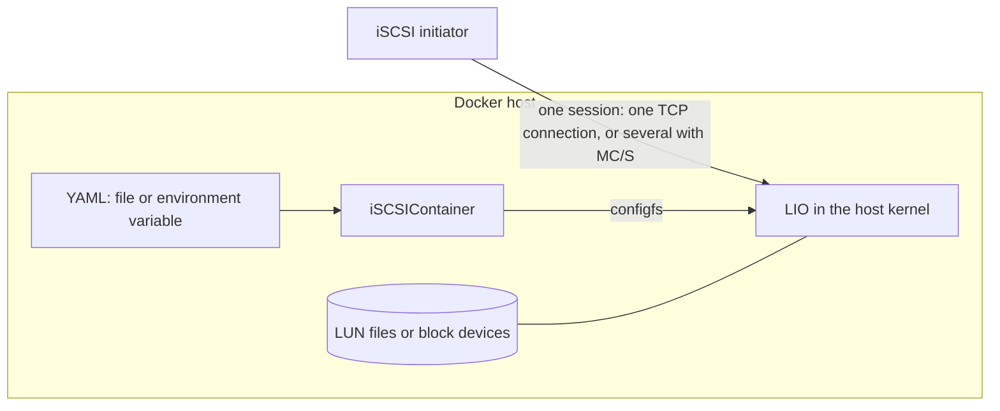

# iSCSIContainer

An iSCSI target in a Docker container, configured by one YAML document in the stack.
It drives the Linux kernel target (LIO) of the Docker host. Optionally it allows MC/S (Multiple
Connections per Session), so a single LUN can use more than one network link; by default each session
has a single connection.

> **Status:** in development. There is no release yet.

## How it works

- LIO is part of the host kernel. The container loads the target modules, builds the configuration in
  the kernel from the YAML on start, and clears it on stop. Nothing is saved.
- The YAML is the only source of the configuration. To change it, edit the YAML and restart the
  container; connected initiators reconnect.
- The portal binds to specific addresses or to all addresses of one or more interfaces, as set in the
  YAML; there is no default. With `network_mode: host`, the recommended setup, these are
  interfaces of the host under their host names. IPv4 and IPv6 are used as configured.
  Addresses are read at start only; where the IPv6 prefix changes, name the stable addresses (IPv4
  and ULA) instead of an interface.
- The container needs `privileged: true`. Nothing else on the host may manage the LIO configuration.
- Linux kernels up to at least 6.12 can crash when a target is stopped while an initiator holds a
  session with several connections (MC/S). A separate module service in the stack builds a
  patched `iscsi_target_mod` for the running kernel; the target loads it. Without the patched module MC/S
  is switched off: every session gets a single connection and a warning is logged. This is
  maintained for Debian kernels only; on other distributions you have to take care of the patch
  yourself.

## License

GNU AGPL v3, see [LICENSE](LICENSE) and [NOTICE](NOTICE).

## Support Me

If iSCSIContainer helps you, you can support it: [Buy Me a Coffee](https://ko-fi.com/motwok)
