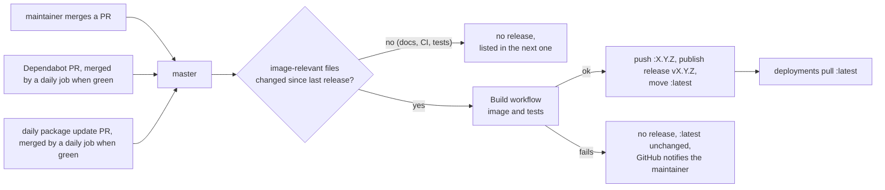

# Releasing iSCSIContainer

iSCSIContainer is released as two container images, the target `ghcr.io/motwok/iscsicontainer` and the
module service `ghcr.io/motwok/iscsicontainer-module`, with one common version in
[Semantic Versioning](https://semver.org) (0.x before 1.0). **Every merge into `master` that changes an
image is a release** of both. Merges that only touch documentation or CI build nothing new; they are listed in
the next real release. There is no manual release step: merging a pull request is the approval.

Releases are switched on with the repository variable `RELEASE_ENABLED`. As long as it is not `true`
(before the first release), the Build workflow only builds and tests.

## Images

Both images are based on `debian:trixie-slim` and tagged `:X.Y.Z` and `:latest`. Each tag is a manifest
list for `linux/amd64` and `linux/arm64`; Docker picks the matching platform.

## Workflows at a glance

| Workflow | File | Trigger | What it does |
|---|---|---|---|
| **Build** | `build.yml` | PR to `master`, push to `master`, manual | Builds both images for both platforms and runs the tests. On `master` (push or started by hand), when an image changed since the last release, it pushes `:X.Y.Z` of both, publishes the release `vX.Y.Z` and moves `:latest`. |
| **Release Drafter** | `release-drafter.yml` | PR events | Labels pull requests from their Conventional Commit titles. The release notes are written by the release job in **Build**, only when there is a release. |
| **Package update** | `packages.yml` | daily, manual | Builds both images, writes their installed package versions to `packages/` (one file per image) and opens a PR if they changed and starts **Build** on it. |
| **Dependabot** | `.github/dependabot.yml` | Dependabot schedule | Opens PRs for the GitHub Actions used. |
| **Merge green update PRs** | `dependabot-automerge.yml` | daily, manual | Merges the green Dependabot and package PRs, then starts **Build** on `master` (merges made by a workflow start no workflow themselves). |

## Release flow

## Version numbers

The next version follows from the labels of the merged pull requests:

| Labels | Version step |
|---|---|
| `breaking`, `major` | major |
| `feature`, `enhancement` | minor |
| anything else (`fix`, `docs`, `chore`, `dependencies`, no label) | patch |

Labels are set automatically from Conventional Commit titles (`feat:`, `fix:`, `docs:`, ...).

## Base image and dependency updates

The base image is referenced **by tag only**, without a digest, and every image build upgrades the
distribution's packages. So each build has the current package state.

- **Package updates:** a daily workflow builds both images and records their installed package
  versions in `packages/`. If they changed, it opens a pull request `chore(deps): update image packages`, which
  is merged automatically once the build passes. That merge is a patch release like any other. Security
  fixes of Debian therefore reach `:latest` within about a day.
- **Dependabot** opens pull requests for the GitHub Actions used; they are merged automatically once
  the build passes. It checks **daily**, but waits **3 days** after a new
  version appears before proposing it (cooldown). Security updates for known vulnerabilities are not
  delayed.
- **A new Debian release** (the Debian base tag is a codename) is adopted by hand.
- Version tags are never rebuilt. No release without a green build.

> **Risk:** a merged dependency update that is itself vulnerable or compromised is shipped without
> anyone having looked at it.

If you want to control updates yourself, **pin a version tag** (`:X.Y.Z`) instead of `:latest` and
update deliberately after reading the release notes.

## Rollback

Version tags are never rebuilt. Pin the deployment to the version tag of an earlier release instead of
`:latest`, then switch back to `:latest` once a fixed release is published.

## Deployment

iSCSIContainer only publishes images. Pulling `:latest` and redeploying the
container is up to the deployment, for example a scheduled stack redeploy. No credentials are
needed: the repository and the image are public.

A redeploy restarts the container, which clears the target configuration and builds it again from the
YAML: connected initiators lose their sessions for that moment and reconnect.
